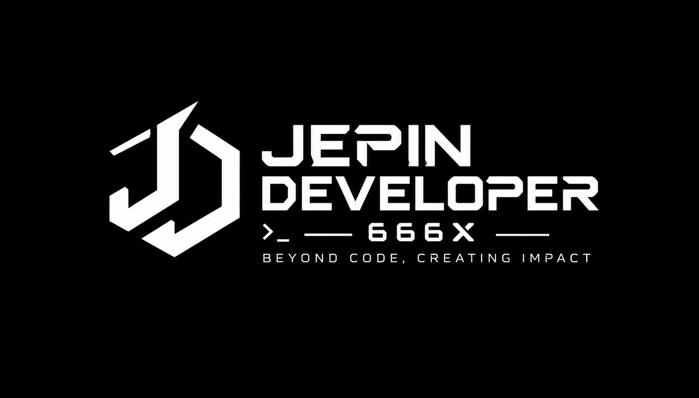

   
  
    

   
  &nbsp;
  

---

# Hey, I'm Jepin 👋

**Also known as Jepin666X**

I'm a developer who enjoys building web applications, Android projects, and digital tools. I like exploring new technologies, solving problems, and turning ideas into working projects.

I enjoy learning by experimenting with code, improving existing projects, and developing applications that are useful and easy to use.

🚀 What I'm Working On

- Developing **ZarStream**, a modern Android media streaming application.
- Building **RTKU Jago** (`rtkujago.site.je`), a web-based neighborhood administration & resident management system.
- Creating **RentalPSku** (`rentalpsku.site.je`), an automated self-service PlayStation rental system via QRIS on TV without a cashier.
- Developing **Gamih Jati** (`gamihjati.xo.je`), a table-side QRIS food & beverage ordering system.
- Exploring web development, backend systems, and Android app architecture.
- Learning more about application security and software development.

### 🎯 My Goals

- Improve my programming skills.
- Build useful and original projects.
- Learn new technologies and frameworks.

---

  

## 🌐 Connect With Me

  <table>
    <tr>
      <td align="center" valign="middle" width="45%">
        
      </td>
      <td align="center" valign="middle" width="55%">
        
          
        
          
        
          
        
      </td>
    </tr>
  </table>

---

  

---

## 📊 GitHub Analytics

  

  

 

  

---

  <h2><i>Contribution Activity 📈</i></h2>
  

---

  

---

## 🌟 Quest Harian

> "Belajar bukan beban, tapi tiket keluar dari kebingungan."

---

  

  Made with dedication by Jepin.

